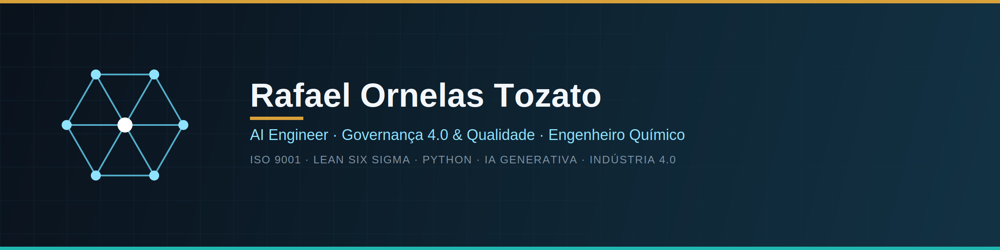

  

  
  
  
  
  
  
  
  
  

# Rafael Ornelas Tozato

> **AI Engineer | Especialista em Governança 4.0 e Qualidade | Engenheiro Químico**

---

## 📌 Perfil e Objetivo Profissional

Especialista em Garantia da Qualidade, Governança Industrial e Indústria 4.0. Experiência sólida em processos químicos, ISO 9001, melhoria contínua e Lean Six Sigma, combinada com transição digital para Data Analytics, engenharia de software Full-Stack e Inteligência Artificial Aplicada (automação local de agentes e LLMs offline).

* **Cargo Alvo:** AI Engineer / Especialista em Governança 4.0 e Qualidade / Analista de Inteligência de Negócio
* **Idiomas:** Inglês e Espanhol (Intermediário)

---

## 🛠️ Principais Competências

**Linguagens & Frameworks:** Python, JavaScript (Node.js), DAX, SQL, HTML5/CSS3.  
**Inteligência Artificial & Dados:** IA Generativa, Agentes Autónomos (OpenCode/Ollama/Qwen/Gemini), RAG, Model Context Protocol (MCP), LlamaIndex, ChromaDB, Neo4j (Grafos), Power BI, Machine Learning.  
**Engenharia de Software & Infraestrutura:** Cursor IDE, Vercel, GitHub Actions, Docker, Azure, Progressive Web Apps (PWA), REST APIs.  
**Governança & Qualidade:** ISO 9001, SASSMAQ, OEA, ANVISA, Lean Six Sigma (Green Belt), Gestão de Processos, CAPA, Auditorias de Qualidade, Scrum, Git.

---

## 💼 Experiência Profissional

### **Center Tintas Arco Íris Ltda - Decor & Art**
**Analista de Garantia da Qualidade | Gestão de Processos e Conformidade** *(Novembro de 2024 – Fevereiro de 2025)*  
* Manutenção do Sistema de Gestão conforme ISO 9001.
* Padronização de processos produtivos e controle documental.
* Tratativa de não conformidades e implementação de CAPA.
* Suporte a auditorias e monitoramento de indicadores de qualidade.

### **IQL - PAINTS & COATINGS SOLUTIONS**
**Técnico de Garantia da Qualidade e Processos** *(Abril de 2023 – Abril de 2024)*  
* Controle e análise de não conformidades.
* Padronização operacional e revisão de procedimentos.
* Apoio na manutenção de certificações ISO e rastreabilidade técnica.

### **Tintas Altezza**
**Técnico Químico de Laboratório | Adequação de Processos e Conformidade** *(Julho de 2022 – Janeiro de 2023)*  
* Reestruturação do laboratório com adequação a normas e padronização de processos.

### **CGE Sociedade Fabricadora de Peças Plásticas Ltda**
*Controle de Qualidade | Processos Industriais* *(Janeiro de 2016 – Fevereiro de 2017)*  
* Monitoramento de qualidade ao longo da cadeia produtiva e inspeção de processos.

### **IQL Chemical Solutions**
**Químico de Desenvolvimento e Controle de Qualidade** *(Outubro de 2008 – Maio de 2015)*  
* Desenvolvimento de produtos (tintas e aditivos), interface técnica com SENAI e IPT.

---

## 🎓 Formação Acadêmica

* **Centro Universitário UniFatecie**  
  Bacharelado em Engenharia Química *(Maio 2024 - Dezembro 2029)*

---

## 🏆 Consolidação de Certificações Oficiais e Formações

* **Microsoft Learn:** [Transcript Dinâmico (Dynamics 365, ERP, Supply Chain & Cloud)](https://learn.microsoft.com/pt-br/users/rafaelornelastozato-2209/transcript/dzo2wizrzkx2853)
* **Microsoft:** Foundry Agentic Engineer
* **IBM / DIO:** Bootcamp IBM Bob: IA de Nível Empresarial
* **Confluent Cloud:** Desafio Final com Pipeline Real-Time End-to-End
* **Universia / DIO:** Fundamentos de IA Generativa 2026
* **Santander Open Academy:** RAG com ChromaDB, LlamaIndex e Python
* **DIO:** MCP (Model Context Protocol): Dando Superpoderes ao Seu Agente de IA
* **Escola EDTI:** Green Belt / White Belt em Lean Six Sigma
* **DIO:** Pipeline Real-Time End-to-End com Confluent Cloud
* **Santander / DIO:** Aceleração Santander - Primeiros Passos com Python
* **DIO:** Formação Power BI, MySQL, Microsoft Azure e Dashboards Corporativos
* **Católica Lisbon School of Business and Economics:** A Sustentabilidade nas Empresas - Do Diagnóstico ao Reporting
* **Santander Open Academy:** Cursor com Python: Desenvolvimento Inteligente com IA

---

## ✍️ Publicações & Artigos (Medium)

* **Desliguei a internet. Meu agente de IA continuou programando.**
* **SoundGraph: recomendação de músicas explicável com grafos no Neo4j**
* **Arquitetura de agentes de IA e Protocolos de Contexto (MCP)**
* **Da Qualidade Industrial à Inteligência Artificial Aplicada**
* **Da Bancada à Engenharia 4.0: Estratégias de arquitetura, PWA, organização de código e governança de ativos digitais**
* **Da Engenharia à Inteligência Artificial: Concluindo a Trilha IBM na DIO e Consolidando a Nova Era Tecnológica**
* **FinanCIA: Como criei um App de Organização de Finanças Pessoais usando Vibe Coding e IA**
* **Aurora BI: Construindo um Painel Executivo de Inteligência Financeira**
* **Modelagem Dimensional com Power BI: Do Zero ao Star Schema (Projeto Financial Sample)**
* **Da Engenharia à Governança 4.0: Consolidação quantitativa das certificações oficiais e carga horária técnica**

---  

## 💻 Projetos e Portfólios
- **App Ecosystem:** [tozato-ai-core.vercel.app](https://tozato-ai-core.vercel.app)
- **H-Folio:** [h-folio-l0.vercel.app](https://h-folio-l0.vercel.app)

## 🪟 Microsoft Learn 
- **Microsoft Learn:** [rafaelornelastozato-2209](https://learn.microsoft.com/pt-br/users/rafaelornelastozato-2209)

## 🐙 Código e Repositórios
- **GitHub:** [github.com/Rafael-TOZATO](https://github.com/Rafael-TOZATO)

## ✍️ Artigos e Publicações
- **Medium:** [medium.com/@ornelas.tozato](https://medium.com/@ornelas.tozato)

## 📬 Contatos
- 📌 **E-mail:** ornelas.tozato@gmail.com
- 💼 **LinkedIn:** [rafaeltozato81](https://www.linkedin.com/in/rafaeltozato81)
